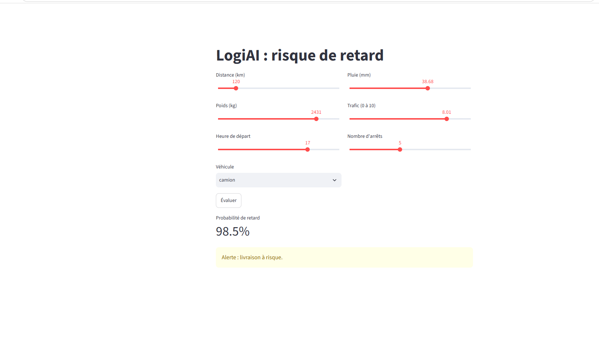
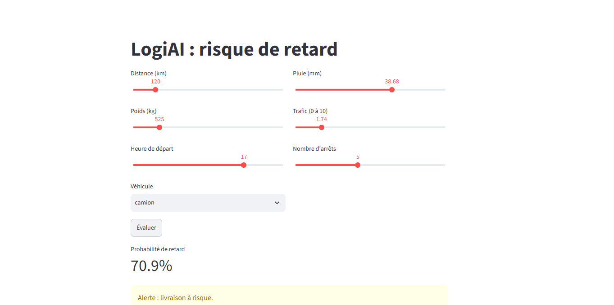
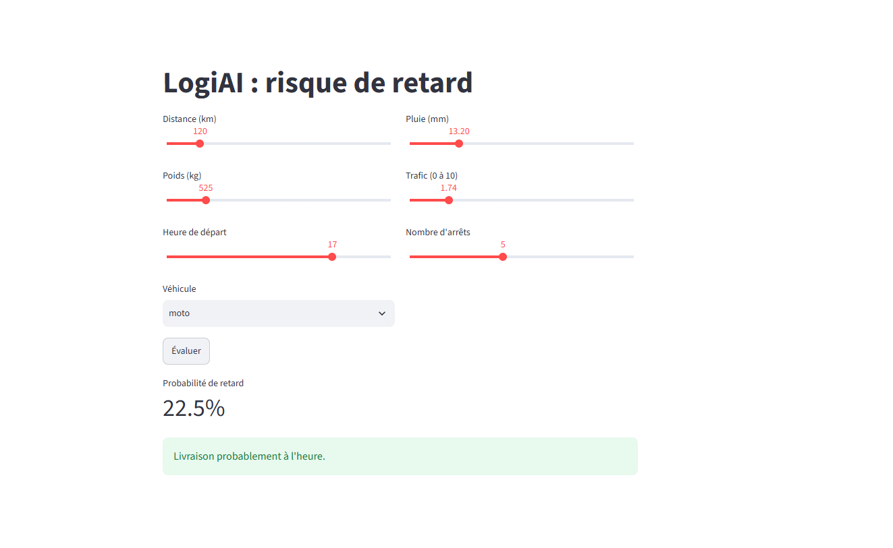

# LogiAI : API REST de prédiction de retard de livraison

**Atelier 3 - API REST avec FastAPI** (module : Développement et déploiement d'applications intelligentes, EMSI, 2026-2027, Pr. Soukaina Gouraguine)

**Binôme :** Taha El Azzouzi, Sara Boufares - **Groupe :** G4

LogiAI prédit le risque de retard d'une livraison et l'expose par une API REST (FastAPI). Une interface Streamlit, qui ne contient pas le modèle, appelle l'API et affiche la probabilité de retard avec une alerte au-dessus du seuil de 0,4.

```
[ Streamlit ] --HTTP/JSON--> [ API FastAPI + modèle ]
```

## Résultats

### Modèle (`python -m logiai.train`)

Jeu de données synthétique de 5000 livraisons, dont 27,4 % en retard.

| Mesure | Valeur |
|---|---|
| Accuracy de la baseline (toujours « à l'heure ») | 0,726 |
| Accuracy du modèle | 0,774 |
| Rappel | 0,464 |
| Précision | 0,617 |
| AUC | 0,769 |

Le rappel de 0,464 signifie que, sur 100 livraisons réellement en retard, le modèle en détecte environ 46. L'accuracy seule est trompeuse, car 72,6 % des livraisons sont déjà à l'heure.

### API

| Route | Rôle |
|---|---|
| `GET /health` | État du service (`status`, `model_loaded`) |
| `POST /v1/predict` | Prédit le risque de retard d'une livraison |

Codes de statut :

| Situation | Code |
|---|---|
| Livraison valide | 200 |
| Valeur hors bornes, champ manquant ou inconnu, mauvais type (distance -5, pluie 500, véhicule « avion », heure 24) | 422 |
| Modèle non chargé | 503 |

Le schéma `Livraison` (`logiai/api/schemas.py`) valide les 7 variables du contrat, avec des bornes physiques :

| Variable | Type | Min | Max |
|---|---|---|---|
| distance_km | float | 1 | 1000 |
| poids_kg | float | 0 | 40000 |
| heure_depart | int | 0 | 23 |
| pluie_mm | float | 0 | 100 |
| trafic_index | float | 0 | 10 |
| nb_arrets | int | 0 | 50 |
| type_vehicule | texte | moto, fourgon ou camion | |

Le modèle est chargé une seule fois, au démarrage du serveur (fonction `lifespan`). Si le fichier du modèle est absent, le serveur démarre quand même et `/v1/predict` répond 503.

Exemple de réponse de `POST /v1/predict` :

```json
{"probabilite_retard": 0.732, "alerte": true, "seuil": 0.4, "model_version": "1.0"}
```

### Tests (`python -m pytest`)

15 tests : les 13 tests du starter et 2 tests ajoutés par le binôme :

- `test_heure_24_refusee` : une heure de départ de 24 est refusée (422) ;
- `test_alerte_coherente_avec_le_seuil` : `alerte` vaut `True` pour un trajet très difficile et `False` pour un trajet très facile.

### Client Streamlit (`streamlit_app.py`)

Trois exemples d'utilisation de l'interface, qui appelle l'API :

| Réglages | Probabilité de retard | Résultat |
|---|---|---|
| Camion, 120 km, 2431 kg, départ 17 h, pluie 38,68 mm, trafic 8,01, 5 arrêts | 98,5 % | Alerte : livraison à risque |
| Camion, 120 km, 525 kg, départ 17 h, pluie 38,68 mm, trafic 1,74, 5 arrêts | 70,9 % | Alerte : livraison à risque |
| Moto, 120 km, 525 kg, départ 17 h, pluie 13,20 mm, trafic 1,74, 5 arrêts | 22,5 % | Livraison probablement à l'heure |







On observe que chaque facteur de risque (poids, pluie, trafic, camion plutôt que moto) augmente la probabilité de retard : en passant de 2431 kg et trafic 8,01 à 525 kg et trafic 1,74, la probabilité baisse de 98,5 % à 70,9 %, puis à 22,5 % avec une moto et moins de pluie.

## Compte rendu

Le compte rendu du TP (bornes du schéma, réponses aux questions, décision « modèle absent ») se trouve dans [`COMPTE_RENDU.md`](COMPTE_RENDU.md).

## Installation (une fois)

    python -m venv .venv
    .venv\Scripts\activate.bat        # Windows cmd  (PowerShell : .venv\Scripts\Activate.ps1)
    source .venv/bin/activate         # macOS / Linux
    pip install -r requirements.txt

## Données et modèle

    python -m logiai.dataset          # écrit data/livraisons.csv
    python -m logiai.train            # écrit models/model.joblib et models/model_info.json

## Lancer l'API

    python -m uvicorn logiai.api.main:app --reload
    # puis http://localhost:8000/docs

## Lancer l'interface Streamlit

Dans un second terminal, avec l'API qui tourne :

    python -m streamlit run streamlit_app.py

## Tests

    python -m pytest

## Organisation du dépôt

- `logiai/api/schemas.py` : schémas Pydantic (entrée `Livraison`, sortie `PredictionOut`) ;
- `logiai/api/main.py` : routes `/health` et `/v1/predict` ;
- `logiai/predict.py` : chargement du modèle et prédiction ;
- `logiai/train.py`, `logiai/dataset.py`, `logiai/config.py` : données, entraînement et réglages ;
- `tests/test_api.py` : tests de l'API ;
- `streamlit_app.py` : client Streamlit ;
- `docs/` : captures d'écran.

Les dossiers `.venv/`, `data/*.csv` et `models/` ne sont pas versionnés (voir `.gitignore`).
